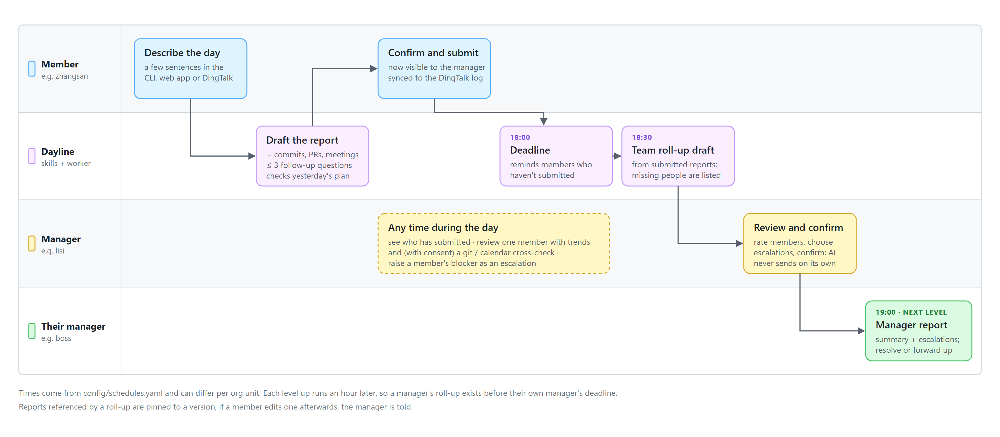
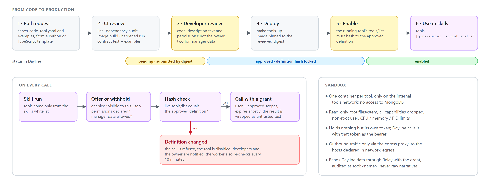

<div align="center">

# Dayline

**An AI daily-report assistant for teams.**<br>
Members write a few sentences, managers review and confirm, and the model only ever drafts.


[Features](#features) · [How it works](#how-it-works) · [Quick start](#quick-start) · [Extending](#extending) · [Deployment](#deployment)


<sub>A manager's home page: their report with the team roll-up, notifications, and who has submitted (demo data).</sub>

</div>

## Features

- **Write in plain words.** Describe your day in a few sentences. Dayline adds the day's commits, PRs and meetings, sorts everything into done / in progress / blocked / plan, asks at most three questions about gaps, and checks yesterday's plan.
- **Reviews with substance.** A one-line summary, vague or unverifiable claims, follow-up questions and a feedback draft. With the member's consent, a manager's review also cross-checks the report against git and calendar.
- **Team roll-ups the manager signs off.** Code gathers each direct report's submitted report; the model drafts highlights, risks and escalation candidates; the manager decides what goes up. Members who didn't submit are listed, never written up from their git data.
- **Escalations along the org tree.** Each level resolves a blocker in place or forwards it, and the whole chain is kept.
- **Private by construction.** Every read goes through one policy layer (Relay). Your manager sees your submitted reports, their manager only sees your manager's roll-up, and every access to someone else's data is audited.
- **Where your team already is.** CLI, web app, REST API and a DingTalk bot. Chinese first, English supported.
- **Extensible without forking.** New workflows are YAML **skills**; new data sources are **member tools**, which are MCP servers written by the team, reviewed and sandboxed.

> **Human in the loop.** Nothing reaches another person until a human confirms it. Dayline doesn't rank or score people, and commit counts are never treated as output.

## How it works


The API, the worker and the DingTalk bot run the same backend core; the `dl` CLI uses it directly for operators. The core rests on a few rules:

1. **Workflows, not a free-roaming agent.** A skill is a fixed sequence: assemble the prompt, run a bounded tool loop, apply deterministic rules, validate against a JSON Schema (one retry), then render. `SkillRunner` is the only code that calls an LLM.
2. **Code decides what the model sees.** Context is fetched by code, as the requesting user, through Relay. The model makes judgements; it never chooses whose data to read.
3. **Untrusted text stays marked.** Narratives, commit messages, calendar titles and tool results are wrapped as untrusted input, and tool whitelists are enforced at call time.
4. **Failover is built in.** The LLM gateway retries, trips a circuit breaker and fails over from Anthropic direct to a proxy to the corporate gateway. Results from a backup endpoint are labelled.

### A day with Dayline



Deadlines are staggered per level (`config/schedules.yaml`), so a manager's roll-up exists before their own manager's deadline. The worker reminds and drafts; it never sends.

## Quick start

You need Python 3.12, Node.js 24, Docker (for MongoDB 8 and the dev stack), and an Anthropic API key or access to a corporate LLM gateway. On Windows, use WSL and keep the venv and `node_modules` on the Linux filesystem.

```bash
make venv                                   # backend + dev extras in ~/.venvs/dayline
cp .env.example .env                        # set ANTHROPIC_API_KEY, etc.
export PATH=$HOME/.venvs/dayline/bin:$PATH

dl llm probe                                # check each LLM endpoint (small real cost)
make dev                                    # mongo + api + worker + web, hot reload, ports on 127.0.0.1
dl db init                                  # indexes
dl org import config/org.example.yaml       # sample org: boss → lisi → zhangsan, wangwu, zhaoliu
dl gen -u zhangsan                          # write your first report
```

Then open the web app at http://localhost:3000. In dev mode you can sign in with a user id such as `lisi`.

## Usage

```bash
# members
dl gen -u zhangsan "Shipped the callback retry; failure rate 2% → 0.3%. Tomorrow: reconciliation export."
dl report history -u zhangsan               # recent reports + cross-day signals
dl review report.md --author Xiaoli         # review a report someone pasted to you

# managers
dl team status -u lisi                      # who has submitted
dl team review zhangsan -u lisi             # rating, trends, questions, feedback draft
dl team rollup -u lisi                      # draft → pick escalations → confirm and send up

# escalations
dl escalations list -u boss
dl escalations resolve <id> -u boss -n "Agreed with the risk team: docs by Wednesday"
```

In DingTalk, send the bot `/gen what I did today` and confirm the card. Managers use `/team` and `/rollup`. `dl <group> --help` lists the rest, including git and calendar connections (`dl integrations`) and consent (`dl consent`).

## Extending

### Skills

A skill is a folder with a `skill.yaml` and a prompt per language. It needs no Python. Built-in skills ship in the image, while `skills/team/` and `skills/user/` are mounted and hot-reloaded.

```yaml
# skills/builtin/generate-daily/skill.yaml (abridged)
name: generate-daily
triggers:
  commands: ["/gen", "dl gen"]
  intents: ["写日报", "write my daily report"]
inputs:
  - {name: narrative, type: text, required: true, max_chars: 20000}
context:
  - {name: own_activity, optional: true}    # today's git / calendar, fetched by code through Relay
tools: [get_recent_reports]                 # member tools are listed as <tool>__<function>
rules: [max-questions, sources-grounded]
model: large                                # tier; mapped to a model per endpoint
fallback: allow
output: {schema: schema.py:DailyReport, template: daily_report}
permissions: [read:own_reports, read:own_activity]
```

`inputs` also generate the web form. Each example in `examples/` serves as a few-shot example and as an eval case. `skills/team/weekly-rollup` and `skills/team/daily-to-english` are worked examples. Format reference: [skills/README.md](skills/README.md).

### VS Code

The extension source is in the repository. Cloning does not install it. From a fresh checkout:

```bash
cd vscode-ext
npm install
npm run compile
npx @vscode/vsce package
code --install-extension dayline-0.1.0.vsix
```

Set `dayline.apiUrl` and `dayline.token` in VS Code. Details: [vscode-ext/README.md](vscode-ext/README.md).

### Member tools

Anyone on the team can add a data source as an MCP server in any language, starting from the Python or TypeScript template.



```bash
dl tools check tools/jira-sprint --url http://localhost:8080/mcp   # contract test + examples
dl tools approve jira-sprint -u qianqi      # a developer other than the owner
make tools-up                               # deploy tool containers + egress proxy
dl tools enable jira-sprint -u qianqi       # live definition must match the approved hash
```

Author and reviewer guide: [tools/README.md](tools/README.md).

## Deployment

```bash
make build                                  # dayline-backend + dayline-web, tagged with the git sha
make up TAG=<git-sha> PROFILE=intranet      # PROFILE = server | intranet | cloud
make backup BACKUP_DEST=backup-host:/srv/backups/dayline
```

Docker Compose runs Caddy (the only public port), the API, the worker, the web app and MongoDB as a single-node replica set on an internal network. DingTalk and the intranet collector are optional profiles. The profiles differ in TLS (automatic certificates, a company certificate, or Caddy's internal CA) and outbound proxying. For offline hosts, `make package` builds an image bundle. `make backup` keeps the last 14 dumps; `make restore-drill` restores one into a scratch database and drops it.

## Documentation

| Document | Contents |
|---|---|
| [Skills](skills/README.md) | writing skills, context providers |
| [Member tools](tools/README.md) | writing, testing and reviewing MCP tools |
| [Evals](backend/evals/README.md) | running skill evals against real endpoints |
| [VS Code](vscode-ext/README.md) | install the extension from a checkout |

## Development

```bash
make test        # backend + web unit tests, no real LLM calls
make lint        # ruff
make web-test    # web typecheck + tests
make eval        # skill evals against each real endpoint (billed)
```

MongoDB-backed tests use `DAYLINE_TEST_MONGO_URI` (default `mongodb://127.0.0.1:27018/?directConnection=true`) and are skipped when it isn't reachable.

```
backend/   FastAPI app, dl CLI, worker, DingTalk bot, tests, evals
web/       Next.js app (backend-for-frontend)
skills/    builtin / team / user skills
tools/     member tool templates and the CI review script
vscode-ext/  VS Code extension source; build and install locally
config/    LLM endpoints, org sample, schedules, templates
docker/    images, Caddy, Mongo init       deploy/   profiles, certificates
docs/      images
```
