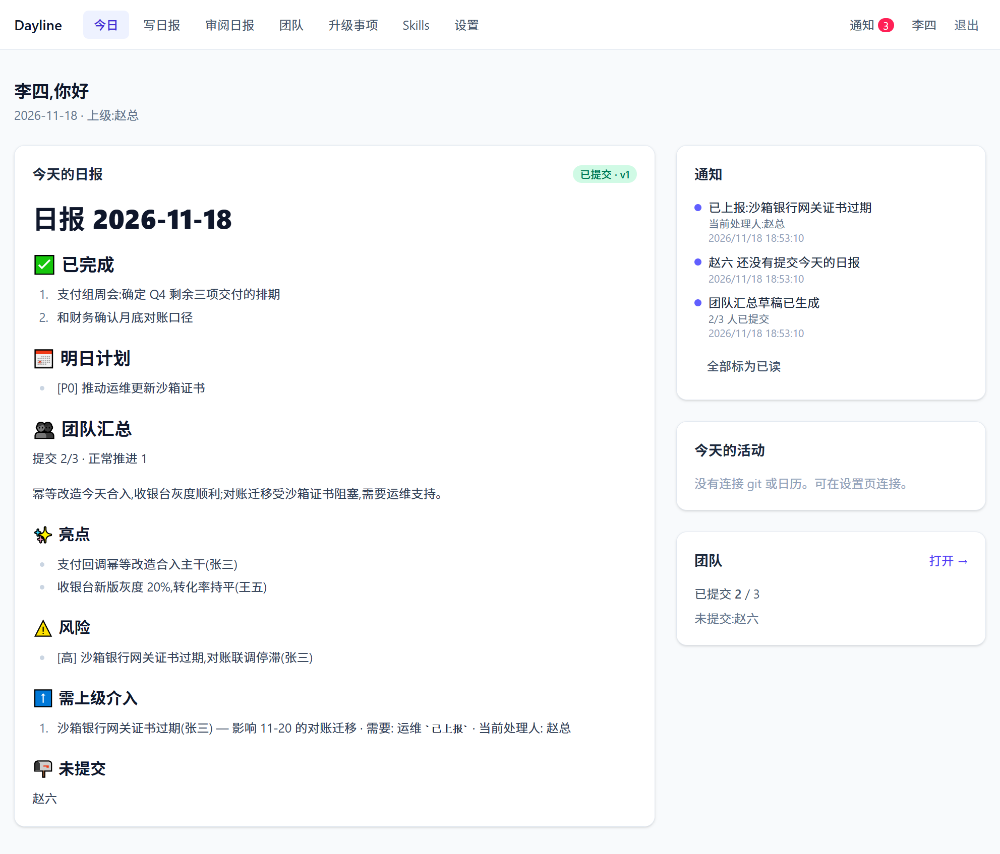
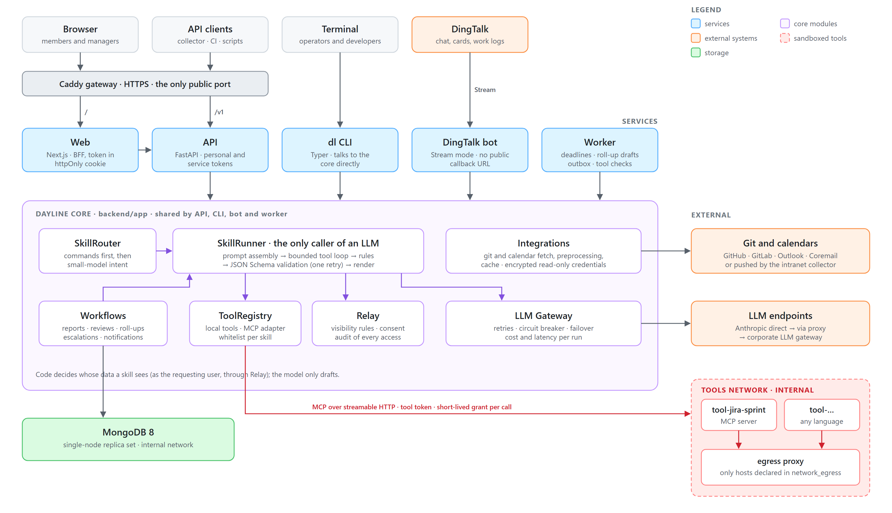

<div align="center">

# Dayline

**An AI daily-report assistant for teams.**<br>
Members write a few sentences. Managers review and confirm. The model only drafts.


[Features](#features) · [Getting started](#getting-started) · [Usage](#usage) · [How it works](#how-it-works) · [Deployment](#deployment)



<sub>A manager's home page: their report with the team roll-up, notifications, and who has submitted.</sub>

</div>

## Features

- **Write in plain words.** Describe the day in a few sentences. Dayline adds that day's commits, pull requests and meetings, sorts the work into done, in progress, blocked and plan, asks at most three questions, and checks yesterday's plan.
- **Reviews with substance.** A one-line summary, vague or unverifiable claims, follow-up questions and a feedback draft. With the member's consent, a manager's review also cross-checks the report against git and calendar.
- **Roll-ups a manager signs.** Code gathers each direct report's submitted report. The model drafts highlights, risks and escalation candidates. The manager decides what goes up. People who did not submit are listed, and their git history is not turned into a report.
- **Escalations along the org tree.** Each level resolves a blocker in place or forwards it. The chain is kept.
- **One place for access rules.** Every read goes through Relay. A manager sees submitted reports. Their manager sees only the roll-up. Access to someone else's data is audited.
- **CLI, web, API, DingTalk and VS Code.** Chinese first, English supported.
- **Skills and member tools.** A new workflow is a folder of YAML and prompts. A new data source is an MCP server the team reviews and runs in a sandbox.

Nothing reaches another person until a human confirms it. Dayline does not rank or score people, and commit counts are not treated as output.

## Getting started

Python 3.12, Node.js 24, and Docker. An API key for Anthropic or an OpenAI-compatible endpoint stays in the environment, not in the repo. On Windows, use WSL and keep the virtualenv and `node_modules` on the Linux filesystem.

```bash
make venv
cp .env.example .env          # set ANTHROPIC_API_KEY, or an OpenAI-compatible endpoint
export PATH=$HOME/.venvs/dayline/bin:$PATH

dl llm probe                  # small real call against each configured endpoint
make dev                      # MongoDB, API, worker and web, with hot reload
dl db init
dl org import config/org.example.yaml
dl gen -u zhangsan
```

Open http://localhost:3000. In dev mode, sign in with a user id such as `lisi`.

The sample org is `boss → lisi → zhangsan, wangwu, zhaoliu`.

## Usage

```bash
# members
dl gen -u zhangsan "Shipped the callback retry; failure rate 2% → 0.3%. Tomorrow: reconciliation export."
dl report history -u zhangsan
dl review report.md --author Xiaoli

# managers
dl team status -u lisi
dl team review zhangsan -u lisi
dl team rollup -u lisi          # draft, pick escalations, confirm and send up

# escalations
dl escalations list -u boss
dl escalations resolve <id> -u boss -n "Agreed with the risk team: docs by Wednesday"
```

`dl <group> --help` lists the remaining commands. `dl integrations` connects git and calendar. `dl consent` grants a manager access to the underlying activity.

In DingTalk, `/gen what I did today` drafts a card to confirm. Managers use `/team` and `/rollup`.

### VS Code

The extension is source in this repo. Install it from a checkout:

```bash
cd vscode-ext
npm install
npm run compile
npx @vscode/vsce package
code --install-extension dayline-0.1.0.vsix
```

Set `dayline.apiUrl` and `dayline.token`. See [vscode-ext/README.md](vscode-ext/README.md).

## How it works



The API, the worker and the DingTalk bot share one backend. The `dl` CLI calls that core directly.

1. A skill is a fixed sequence: assemble the prompt, run a bounded tool loop, apply deterministic rules, validate against a JSON Schema, then render. `SkillRunner` is the only code that calls a model.
2. Code fetches context as the requesting user, through Relay. The model judges the text. It does not choose whose data to read.
3. Narratives, commit messages, calendar titles and tool results are wrapped as untrusted input. A skill can call only the tools named in its manifest.
4. The LLM gateway retries, opens a circuit breaker, and fails over from Anthropic direct to a proxy to another endpoint. A reply from a backup endpoint is labelled.


Deadlines are staggered by level in `config/schedules.yaml`, so a manager's roll-up exists before their own manager's deadline. The worker reminds and drafts. It does not send.

## Skills

A skill is a directory: `skill.yaml` plus a prompt per language. No Python. Built-in skills ship in the image. `skills/team/` and `skills/user/` are mounted and hot-reloaded.

`skills/team/weekly-rollup` turns the caller's recent reports into a weekly summary. `skills/team/daily-to-english` translates a pasted report into English.

```yaml
# skills/builtin/generate-daily/skill.yaml (abridged)
name: generate-daily
triggers:
  commands: ["/gen", "dl gen"]
  intents: ["写日报", "write my daily report"]
inputs:
  - {name: narrative, type: text, required: true, max_chars: 20000}
context:
  - {name: own_activity, optional: true}
tools: [get_recent_reports]
rules: [max-questions, sources-grounded]
model: large
fallback: allow
output: {schema: schema.py:DailyReport, template: daily_report}
permissions: [read:own_reports, read:own_activity]
```

`inputs` become the web form. Files in `examples/` are few-shot examples and eval cases. Format and context providers: [skills/README.md](skills/README.md).

## Member tools

A member tool is an MCP server, in any language, started from the Python or TypeScript template. After review it is listed in a skill as `<tool>__<function>`.


```bash
dl tools check tools/jira-sprint --url http://localhost:8080/mcp
dl tools approve jira-sprint -u qianqi       # a developer other than the owner
make tools-up                                # tool containers and the egress proxy
dl tools enable jira-sprint -u qianqi        # the live definition must match the approved hash
```

Guide: [tools/README.md](tools/README.md).

## Deployment

```bash
make build                                   # dayline-backend and dayline-web, tagged with the git sha
make up TAG=<git-sha> PROFILE=intranet       # server | intranet | cloud
make backup BACKUP_DEST=backup-host:/srv/backups/dayline
```

Docker Compose runs Caddy as the only published port, plus the API, the worker, the web app and MongoDB as a single-node replica set on an internal network. DingTalk and the intranet collector are optional profiles. Profiles differ in TLS (automatic certificates, a company certificate, or Caddy's internal CA) and in outbound proxying. `make package` builds an image bundle for hosts that cannot pull images. `make backup` keeps the last 14 dumps. `make restore-drill` restores one into a scratch database and drops it.

## Documentation

| | |
|---|---|
| [Skills](skills/README.md) | manifests, prompts, context providers |
| [Member tools](tools/README.md) | writing, testing and reviewing MCP tools |
| [VS Code](vscode-ext/README.md) | install and settings |
| [Evals](backend/evals/README.md) | skill evals against configured endpoints |

## Contributing

```bash
make test        # backend and web unit tests
make lint        # ruff
make web-test    # web typecheck and tests
make eval        # skill evals against each configured endpoint (billed)
```

MongoDB-backed tests use `DAYLINE_TEST_MONGO_URI` (default `mongodb://127.0.0.1:27018/?directConnection=true`) and are skipped when it is unreachable.

```
backend/     API, dl CLI, worker, DingTalk bot, tests, evals
web/         Next.js app
skills/      builtin, team and user skills
tools/       member-tool templates and tools/ci/review.sh
vscode-ext/  VS Code extension
config/      LLM endpoints, sample org, schedules, templates
docker/      images, Caddy, MongoDB init
deploy/      environment profiles and certificates
docs/        images
```
